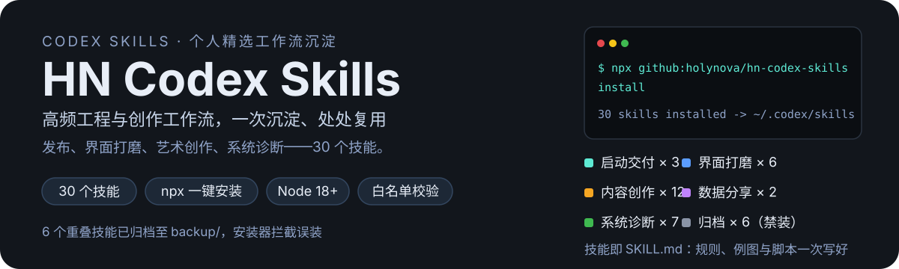
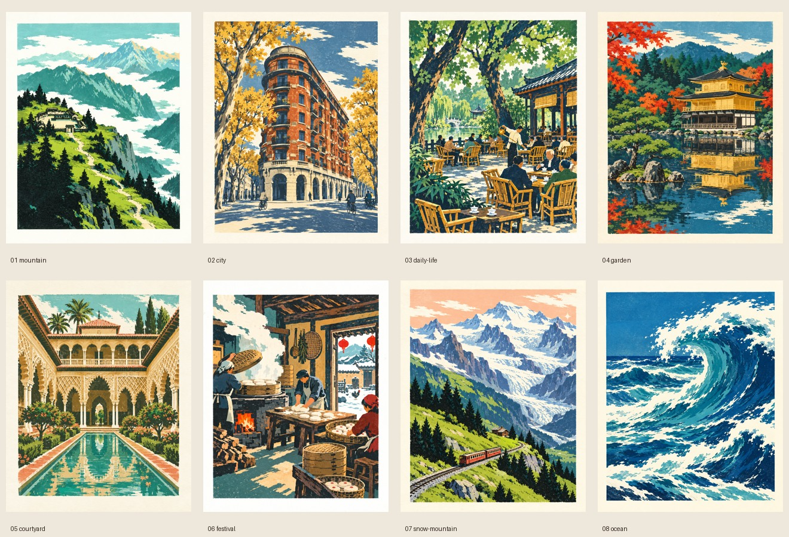

<p align="right"><a href="README.md">中文</a></p>

<p align="center">
  
</p>

<p align="center">
  <a href="#installation">▶ Installation</a>
  ·
  <a href="#skills">Skills</a>
  ·
  <a href="https://github.com/holynova/hn-codex-skills">GitHub Repository</a>
</p>

A curated Codex skills collection: high-frequency workflows for shipping, UI polish, creative work and system diagnostics, captured as skills so you never re-explain complex rules to an AI. 30 skills, one `npx` command to install into any Codex setup.


The publishing skill fills missing Chinese or English documentation and reuses complete bilingual READMEs.

## Showcase

<p align="center">
  
</p>

*The 8 must-read reference images for the `hn-color-woodcut` multicolor woodcut skill — art skills bundle style references; read the pictures before generating.*

## Skills

### Project Kickoff & Delivery

| Skill | In one line |
| --- | --- |
| [hn-start](skills/hn-start/SKILL.md) | Restate a new project brief, clarify decisions that affect delivery, and challenge assumptions |
| [hn-project-publisher](skills/hn-project-publisher/SKILL.md) | First-time web project release and release checks: fill gaps only, never re-release |
| [hn-chrome-extension-publisher](skills/hn-chrome-extension-publisher/SKILL.md) | Chrome extension publishing: Manifest V3 audit, packaging, SHA256 verification, submission guidance |

### UI Polish & Visual Assets

| Skill | In one line |
| --- | --- |
| [hn-ui-layout-typography-audit](skills/hn-ui-layout-typography-audit/SKILL.md) | UI layout and typography audit: contrast, repetition, alignment, proximity |
| [hn-ui-check](skills/hn-ui-check/SKILL.md) | Batch UX audit of GitHub projects: ten product standards, audit branch + unmerged PRs |
| [hn-website-completeness-check](skills/hn-website-completeness-check/SKILL.md) | Website gap check: favicon, share cards, metadata, mobile, image performance |
| [hn-image-loading-optimizer](skills/hn-image-loading-optimizer/SKILL.md) | Image-heavy site loading optimization: three-tier assets, lazy loading, batched rendering |
| [hn-tool-ui-polisher](skills/hn-tool-ui-polisher/SKILL.md) | Small-tool UI polish: control alignment, state flow, mobile adaptation |
| [hn-visual-asset-pipeline](skills/hn-visual-asset-pipeline/SKILL.md) | Visual asset pipeline: favicons, app icons, cover images, transparent PNGs, store graphics |

### Creative & Content

| Skill | In one line |
| --- | --- |
| [hn-hok-skin-prompt](skills/hn-hok-skin-prompt/SKILL.md) | Honor of Kings × anime crossover skin prompts, with 3 on-device calibration screenshots |
| [hn-ink-dance-sketch](skills/hn-ink-dance-sketch/SKILL.md) | Ink-line dance sketches: loose ink lines, warm paper whitespace, 6 must-read examples |
| [hn-xiaohei-draw](skills/hn-xiaohei-draw/SKILL.md) | "Xiaohei the astronaut" IP illustrations for Chinese articles: white-background hand-drawn sketches with red, orange, and blue annotations |
| [hn-poem](skills/hn-poem/SKILL.md) | Modern Chinese short poems: four at a time, four defamiliarization techniques |
| [rubber-stamp-art](skills/rubber-stamp-art/SKILL.md) | Rubber stamps and woodblock prints: Xuan paper texture, mineral ink, hand-carved marks |
| [hn-vintage-book-cover](skills/hn-vintage-book-cover/SKILL.md) | Create Chinese literary book covers with spot inks, negative space, and integrated lettering. Includes four visual examples. |
| [hn-paper-gouache](skills/hn-paper-gouache/SKILL.md) | Paper-textured flat gouache illustrations: cities, landmarks, and nature, 6 must-read examples |
| [hn-color-woodcut](skills/hn-color-woodcut/SKILL.md) | Multicolor woodcut · landscapes in print: flat color layers, hand-carved knife marks, 8 must-read examples |
| [twilight-anime-art](skills/twilight-anime-art/SKILL.md) | Twilight anime illustrations: pink-purple dusk, amber warm light, 5 must-read examples |
| [hn-flowing-pen-art](skills/hn-flowing-pen-art/SKILL.md) | Flowing pen drawings: warm aged paper, deep blue ink, contour-following strokes, 5 required examples |
| [hn-translucent-toy](skills/hn-translucent-toy/SKILL.md) | Translucent uniform and armor toy image generation: thick resin shells, bright clashing colors, 6 examples |
| [hn-notebooklm-ppt](skills/hn-notebooklm-ppt/SKILL.md) | NotebookLM CLI batch PPT production and ultra-clear web/PDF delivery pipeline |

### Analytics & Sharing

| Skill | In one line |
| --- | --- |
| [hn-web-analytics](skills/hn-web-analytics/SKILL.md) | Centralized Umami analytics: unified PV, UV, and custom events across sites |
| [hn-share-card](skills/hn-share-card/SKILL.md) | Result share cards: Canvas-generated, with QR code and key outcomes |

### Diagnostics & Automation

| Skill | In one line |
| --- | --- |
| [hn-daily](skills/hn-daily/SKILL.md) | Daily maintenance orchestrator: parallel software updates + token stats, serial skills sync, and Mole cleanup/optimize |
| [hn-ai-software-update](skills/hn-ai-software-update/SKILL.md) | AI software & CLI updater: concurrently upgrades AI CLIs, Mole, and apps via their native package managers |
| [hn-skills-sync](skills/hn-skills-sync/SKILL.md) | Skills sync & update: upgrades third-party skills and syncs new/updated skills from GitHub across agent dirs |
| [hn-token-stats](skills/hn-token-stats/SKILL.md) | AI token telemetry cards: 7-day totals rounded to 10k/100M with 1/8-block precision bars |
| [hn-clean](skills/hn-clean/SKILL.md) | macOS disk analysis and cleanup: Mole `clean`/`optimize` preview & execution with `df -k` verification |
| [hn-windows-stability-doctor](skills/hn-windows-stability-doctor/SKILL.md) | Windows stability diagnostics: blue screens, freezes, WHEA, driver crashes |
| [hospital-record-collector](skills/hospital-record-collector/SKILL.md) | Automatic collection and archiving of medical receipts and records |

## Installation

Requires Node.js 18+. Installs to `$CODEX_HOME/skills` by default (`~/.codex/skills` if unset).

```bash
# Install all 30 skills
npx github:holynova/hn-codex-skills install

# Install just one
npx github:holynova/hn-codex-skills install hn-project-publisher

# Force-overwrite existing skills with the same name / custom directory / dry run
npx github:holynova/hn-codex-skills install --force
npx github:holynova/hn-codex-skills install --path /custom/skills/dir
npx github:holynova/hn-codex-skills install --dry-run
```

The installer preflights and stages all targets, replaces atomically, and rolls back on failure; art skills' reference images install alongside the skill and are verified byte-for-byte.

## Layout

```
hn-codex-skills/
├── bin/install.mjs        npx installer CLI (allowlist validation + atomic replace + rollback)
├── skills/                30 active skills (each with SKILL.md; art skills include must-read examples)
├── backup/                6 archived skills (overlapping features / legacy flows, never install)
├── tests/                 Automated tests (installer, release flow, Chrome packaging safety)
├── CHANGELOG.md
└── package.json           version 1.0.0, Node >= 18
```

## Archived Skills

6 overlapping skills have been moved to `backup/` (`hn-frontend-project-shipper`, `hn-github-works`, `hn-data-to-github-pages-gallery`, and others). The installer validates against an allowlist and rejects any attempt to install an archived skill outright.
