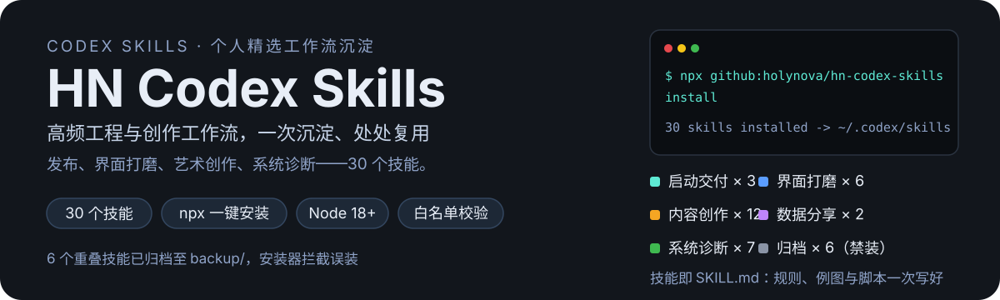

<p align="center">
  
</p>

<p align="center">
  <a href="#安装--installation">▶ 安装 Installation</a>
  ·
  <a href="#技能目录--skills">技能目录 Skills</a>
  ·
  <a href="https://github.com/holynova/hn-codex-skills">GitHub 仓库</a>
</p>

个人精选的 Codex Skills 体系：把高频的工程发版、界面打磨、内容创作与系统诊断工作流沉淀为技能，避免每次与 AI 对话时重复说明复杂规则。24 个技能，一条 `npx` 命令装进任意环境的 Codex。

A curated Codex skills collection: high-frequency workflows for shipping, UI polish, creative work and system diagnostics, captured as skills so you never re-explain complex rules to an AI. 24 skills, one `npx` command to install into any Codex setup.

## 示例 / Showcase

<p align="center">
  
</p>

*`hn-color-woodcut` 套色木刻技能的 8 张必读例图总览——艺术类技能均内置风格例图，生成前先看图校准。*

## 技能目录 / Skills

### 发布与交付 · Publishing & Releasing

| 技能 | 一句话 |
| --- | --- |
| [hn-project-publisher](skills/hn-project-publisher/SKILL.md) | Web 项目首次发布与发布检查：只补缺口，不重复发布 |
| [hn-chrome-extension-publisher](skills/hn-chrome-extension-publisher/SKILL.md) | Chrome 扩展上架：Manifest V3 审计、打包、SHA256 校验、提审指导 |

### 界面打磨与视觉资产 · UI & Visual Assets

| 技能 | 一句话 |
| --- | --- |
| [hn-ui-layout-typography-audit](skills/hn-ui-layout-typography-audit/SKILL.md) | UI 布局与排版审计：对比、重复、对齐、亲密性四原则 |
| [hn-ui-check](skills/hn-ui-check/SKILL.md) | GitHub 项目体验批量审计：十条产品标准，审计分支 + 未合并 PR |
| [hn-website-completeness-check](skills/hn-website-completeness-check/SKILL.md) | 网站查缺补漏：favicon、分享卡片、元数据、移动端、图片性能 |
| [hn-image-loading-optimizer](skills/hn-image-loading-optimizer/SKILL.md) | 图片密集站加载优化：三层资产、懒加载、分批渲染 |
| [hn-tool-ui-polisher](skills/hn-tool-ui-polisher/SKILL.md) | 小工具界面打磨：控件对齐、状态流转、移动端自适应 |
| [hn-visual-asset-pipeline](skills/hn-visual-asset-pipeline/SKILL.md) | 视觉资产流水线：Favicon、App 图标、题图、透明 PNG、商店图 |

### 内容创作与艺术表达 · Creative & Content

| 技能 | 一句话 |
| --- | --- |
| [hn-hok-skin-prompt](skills/hn-hok-skin-prompt/SKILL.md) | 王者荣耀 × 动漫联动皮肤提示词，附 3 张真机校准截图 |
| [hn-ink-dance-sketch](skills/hn-ink-dance-sketch/SKILL.md) | 墨线舞蹈速写：疏放墨线、暖纸留白，6 张必读例图 |
| [hn-xiaohei-draw](skills/hn-xiaohei-draw/SKILL.md) | "宇航员小黑"IP 中文正文配图：白底手绘线稿 + 红橙蓝标注 |
| [hn-poem](skills/hn-poem/SKILL.md) | 现代汉语短诗：一次四首，四种陌生化手法 |
| [rubber-stamp-art](skills/rubber-stamp-art/SKILL.md) | 橡皮图章与木刻版画：宣纸质感、矿物印泥、手工刻痕 |
| [hn-paper-gouache](skills/hn-paper-gouache/SKILL.md) | 纸纹平涂水粉插画：城市、地标与自然，6 张必读例图 |
| [hn-color-woodcut](skills/hn-color-woodcut/SKILL.md) | 套色木刻 · 山河入版：平涂套色、手刻刀痕，8 张必读例图 |
| [twilight-anime-art](skills/twilight-anime-art/SKILL.md) | 暮色动画插画：粉紫暮色、琥珀暖光，5 张必读例图 |
| [hn-flowing-pen-art](skills/hn-flowing-pen-art/SKILL.md) | 流线钢笔画：暖旧纸、深蓝墨色、随形排线，5 张必需例图 |
| [hn-translucent-toy](skills/hn-translucent-toy/SKILL.md) | 半透明制服与盔甲玩具生图：厚壳树脂、鲜亮撞色，6 张例图 |
| [hn-notebooklm-ppt](skills/hn-notebooklm-ppt/SKILL.md) | NotebookLM CLI PPT 批量生产与超清 Web/PDF 交付流水线 |

### 数据埋点与交互分享 · Analytics & Sharing

| 技能 | 一句话 |
| --- | --- |
| [hn-web-analytics](skills/hn-web-analytics/SKILL.md) | Umami 统计集中接入：多站统一 PV、UV 与自定义事件 |
| [hn-share-card](skills/hn-share-card/SKILL.md) | 结果分享卡片：Canvas 生成，带二维码与关键成果 |

### 系统诊断与日常自动化 · Diagnostics & Automation

| 技能 | 一句话 |
| --- | --- |
| [hn-clean](skills/hn-clean/SKILL.md) | macOS 磁盘分析与清理：Mole 预览核实，按授权清理 |
| [hn-windows-stability-doctor](skills/hn-windows-stability-doctor/SKILL.md) | Windows 稳定性诊断：蓝屏、死机、WHEA、驱动崩溃 |
| [hospital-record-collector](skills/hospital-record-collector/SKILL.md) | 医疗票据与病历自动采集归档 |

## 安装 / Installation

需要 Node.js 18+。默认装到 `$CODEX_HOME/skills`（未设置则为 `~/.codex/skills`）。

```bash
# 全量安装 24 个技能
npx github:holynova/hn-codex-skills install

# 只装一个
npx github:holynova/hn-codex-skills install hn-project-publisher

# 强制覆盖已有同名技能 / 指定目录 / 只看计划不安装
npx github:holynova/hn-codex-skills install --force
npx github:holynova/hn-codex-skills install --path /custom/skills/dir
npx github:holynova/hn-codex-skills install --dry-run
```

安装器先预检并暂存全部目标，原子替换，失败回滚；艺术类技能的例图会随技能一起安装并逐字节校验。

## 仓库结构 / Layout

```
hn-codex-skills/
├── bin/install.mjs        npx 安装器 CLI（白名单校验 + 原子替换 + 回滚）
├── skills/                24 个正式技能（每个含 SKILL.md，艺术类含必读例图）
├── backup/                6 个归档技能（功能重叠 / 历史流程，严禁安装）
├── tests/                 自动化测试（安装器、发布流程、Chrome 打包安全）
├── CHANGELOG.md
└── package.json           version 1.0.0，Node >= 18
```

## 安全与隔离 / Archived Skills

功能重叠的 6 个技能已移入 `backup/` 归档（`hn-frontend-project-shipper`、`hn-github-works`、`hn-data-to-github-pages-gallery` 等）。安装器按白名单校验，尝试安装归档技能会直接报错拦截。

## English

**HN Codex Skills** is a curated collection of 24 Codex skills — personal high-frequency workflows for shipping, UI polish, creative work and diagnostics, captured so you never re-explain complex rules to an AI.

- **Publishing (2)**: `hn-project-publisher` (first-time web project release + gap-only re-release checks), `hn-chrome-extension-publisher` (Manifest V3 audit, packaging, SHA256, store submission).
- **UI & visual assets (6)**: layout/typography audit, batch UX audit against ten product standards (`hn-ui-check`), website completeness check, image-loading optimization, tool-UI polishing, visual asset pipeline.
- **Creative (11)**: Honor of Kings × anime skin prompts, ink dance sketch, "Xiaohei astronaut" article illustrations, modern Chinese poetry, rubber-stamp art, paper gouache, multicolor woodcut, twilight anime art, flowing pen art, translucent toy figures, NotebookLM PPT production. Art skills bundle mandatory visual references — read the pictures before generating.
- **Analytics & sharing (2)**: Umami analytics setup, share-card generation.
- **Diagnostics (3)**: macOS disk cleanup, Windows stability/BSOD diagnosis, hospital record collection.
- **Install** (Node 18+): `npx github:holynova/hn-codex-skills install` — all 24 skills to `$CODEX_HOME/skills` (or `~/.codex/skills`); install one with `install <name>`; `--force`, `--path`, `--dry-run` supported. The installer preflights, stages, atomically replaces and rolls back on failure; art references are verified byte-for-byte.
- **Safety**: 6 overlapping skills are archived under `backup/` and blocked from installation by an allowlist.

## 许可 / License

MIT（见 `package.json` 的 license 字段；仓库暂无 LICENSE 文件）。
